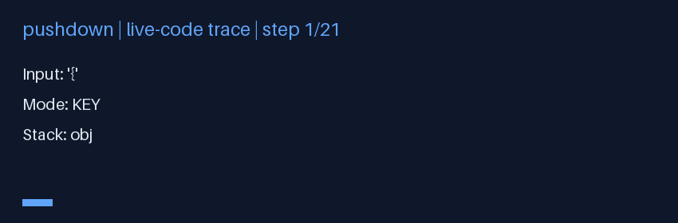
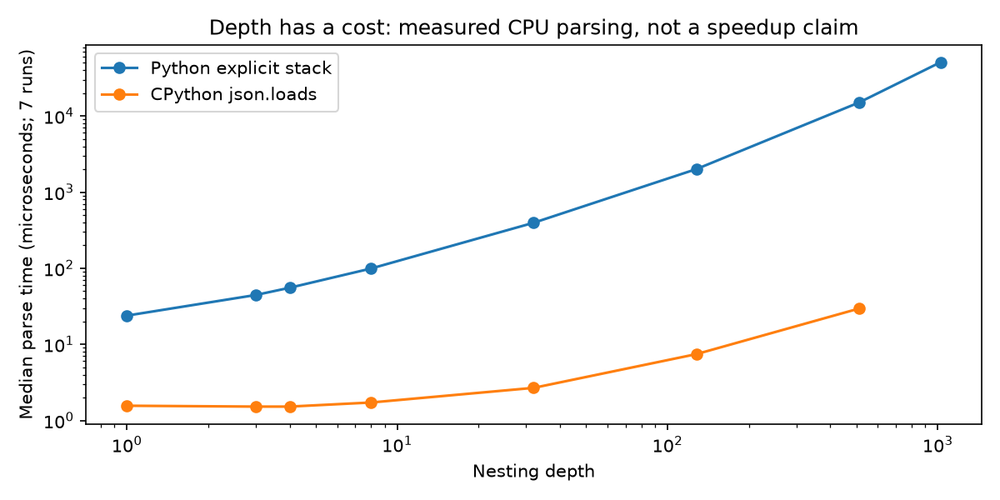
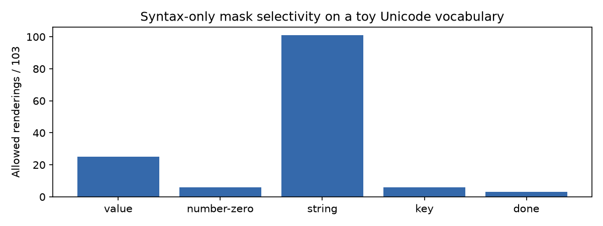

# pushdown — JSON prefix masks you can inspect

**A correctness study, not “PDA beats production DFA.”** This package recognizes
JSON syntax incrementally with an explicit container stack and probes Unicode
token renderings without changing the live decoder. The only capped comparison
is a synthetic wrapper around the same parser. **XGrammar is not a bounded DFA**;
neither XGrammar nor Outlines is benchmarked here.



## The contract, before the benchmark

`feed(character)` accepts one Unicode character if the resulting state is a
viable JSON prefix. `finish()` closes a trailing scalar and checks whole-document
acceptance. `final_ok()` is a non-mutating EOS query. A failed feed enters `DEAD`.
`accepts(text)` resets the recognizer and validates a complete document.

```python
from pushdown import build_mask, mask_step

mask, parser = build_mask("0", ["1", ".", "e", " "])
assert mask == [False, True, True, True]
assert parser.final_ok()  # 0 may end now, but 0. / 0e may still continue
assert mask_step(parser, [".5", "e"], eos_legal=True) == [True, False]
```

Mask candidates are nonempty, **context-independent Unicode strings**, not raw
UTF-8 byte tokens. Real tokenizer integration needs a byte-to-text adapter and
special-token policy. A vocabulary that cannot spell the necessary continuation
can still deadlock; grammar viability is not vocabulary-relative reachability.
The default character query is ASCII; pass a finite Unicode alphabet to
`allowed_chars(alphabet)` when required.

### Syntax and semantics are separate

The mask enforces syntax only. `SideMemory` is an optional, manually driven
scalar-event helper for uniqueness and captured equality. It is not subscribed
to `mask_step`, not a JSON Schema implementation, and not a guarantee of semantic
validity. Container events are `<obj>` / `<arr>` markers, not reconstructed values.
Missing captures do not constrain a candidate; captured `None` does. Rules use
Python equality, not JSON Schema equality. `min_contains` and unknown rules fail
explicitly instead of pretending to enforce constraints. Never use container
markers to claim object/array uniqueness.

## Evidence notebook

The tracked [receipt](receipts/receipt.json) contains source SHA-256, UTC, machine,
Python version and all seven timing samples after two warmups. On this CPU run:

| Input | Result | Median parser time |
|---|---|---:|
| Depth 32 array | accepted | 396 microseconds |
| Depth 512 array | accepted | 15.09 milliseconds |
| Depth 1024 array | accepted | 50.94 milliseconds |
| Depth 4 with synthetic cap 3 | rejected by construction | not a production result |



The CPython `json.loads` reference is much faster; see the chart and raw samples.
It is measured only through depth 512 to avoid its recursion limit. There is no
claim of linear Python execution: immutable tuple stack copies, string buffering,
and completion paths introduce depth-dependent overhead and can produce quadratic
work/storage on deeply nested inputs. “No configured cap” still means finite RAM
and CPU. Numeric values also inherit CPython's conversion limits for very long
integers; finite exponent syntax may overflow to floating infinity in events.

The 103-rendering toy mask keeps 25 at a value position, 101 inside an ordinary
string, 6 at an object key or numeric-zero position, and 3 after document completion.
These are vocabulary-specific counts, not production-vocabulary throughput.



## Reproduce locally

From **this checkout**, not an unrelated package of the same name on PyPI:

```bash
python3 -m venv .venv
. .venv/bin/activate
python -m pip install -e '.[dev,viz]'
python -m pytest -q
ruff check .
ruff format --check .
mypy
python benchmarks/run.py
python demos/make_figures.py
python -m build
```

The scripts resolve output paths relative to themselves. `demos/demo.py` is a
compatibility entry point to the benchmark. CPU GitHub Actions runs the same gates.
Mypy checks all library modules with typed definitions and body checking; Ruff
checks library, tests, demos and benchmarks.

## Audit trail and boundaries

52 collected tests pass. Differential coverage includes 600 seeded JSON
mutations and final-token checks against `json.loads`, numeric prefix enumeration
against an independent grammar regex, escaped event values and surrogate-pair
decoding, strict JSON
whitespace, ASCII numeric grammar, EOS, mask state/event purity, and a synthetic
cap that ignores brackets inside strings. The stdlib reference disallows its
nonstandard `NaN`/`Infinity` constants. JSON duplicate keys and escaped unpaired
surrogates follow stdlib syntax behavior; this is not I-JSON or a Unicode scalar
validation policy. Tests are finite evidence, not a proof over all inputs.

The audit repaired: permissive Unicode whitespace, numeric prefixes that could
never complete, prefix replay that prematurely finalized numbers, polluted probe
events, incorrect escaped scalar/key events, and unsafe production-comparison
claims. It also fixed capture-of-null handling and made unsupported rules explicit.

- [Standalone architecture SVG](assets/architecture.svg) / [offline HTML](assets/architecture.html)
- `pushdown/pda.py`: lexical states and container transitions
- `pushdown/masking.py`: pure candidate replay; no semantic integration
- `pushdown/baseline.py`: synthetic bounded stack only
- `tests/`: behavior-based unit and differential checks
- `benchmarks/run.py`: measured receipt; `demos/make_figures.py`: trace-based figures

## Prior art and license

JSON syntax: [RFC 8259](https://www.rfc-editor.org/rfc/rfc8259).
Structured-decoding context: [XGrammar](https://github.com/mlc-ai/xgrammar) and
[Outlines](https://github.com/dottxt-ai/outlines). These references are attribution,
not benchmark baselines or endorsements. This educational implementation is MIT
licensed; see [LICENSE](LICENSE).
